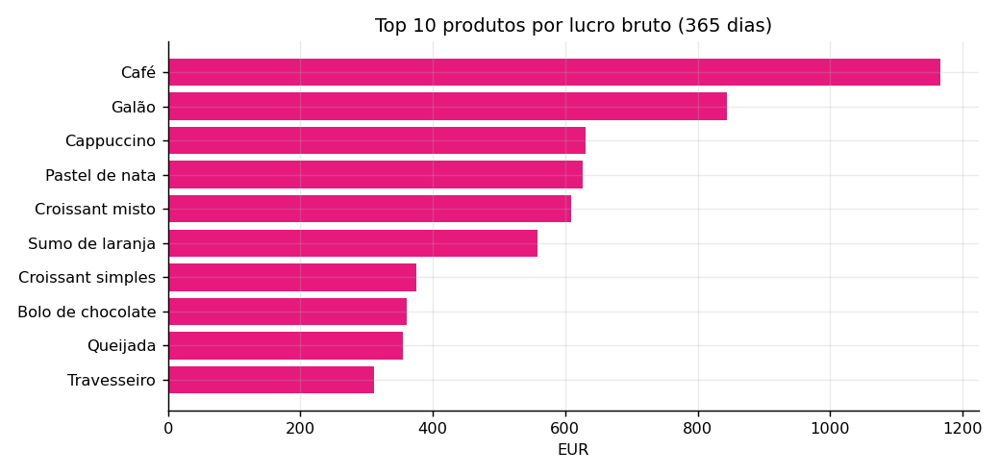
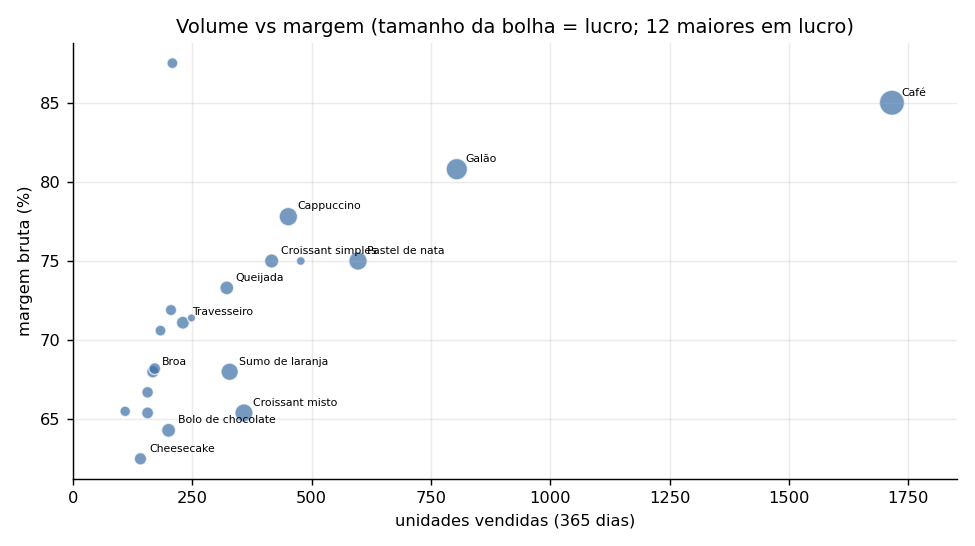
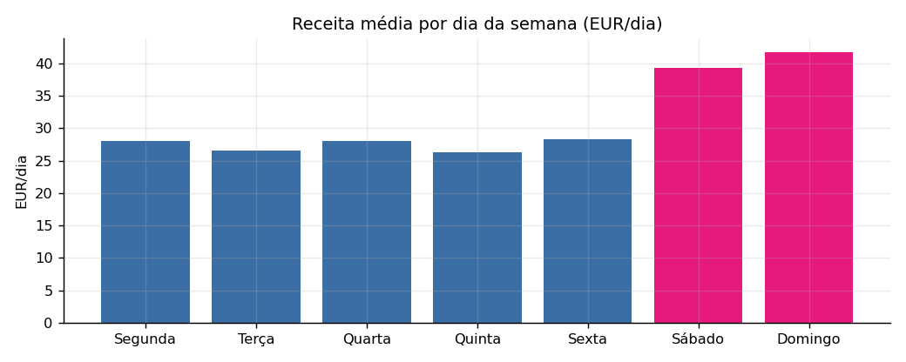
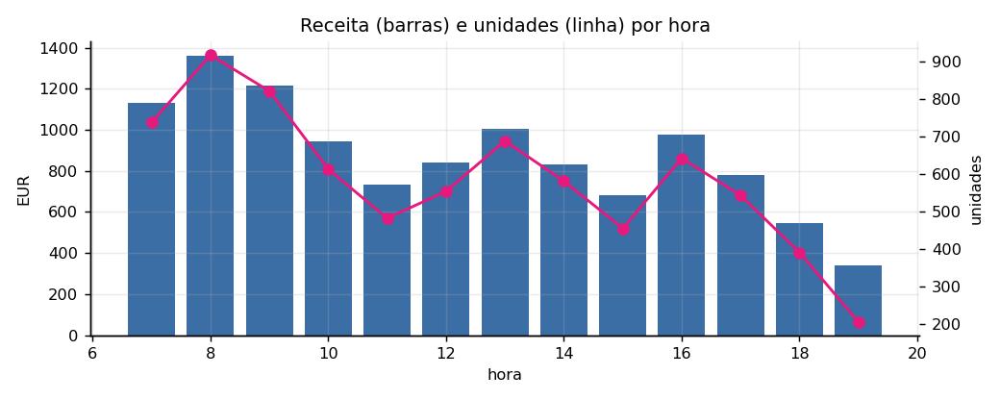
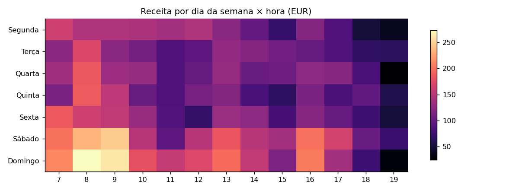
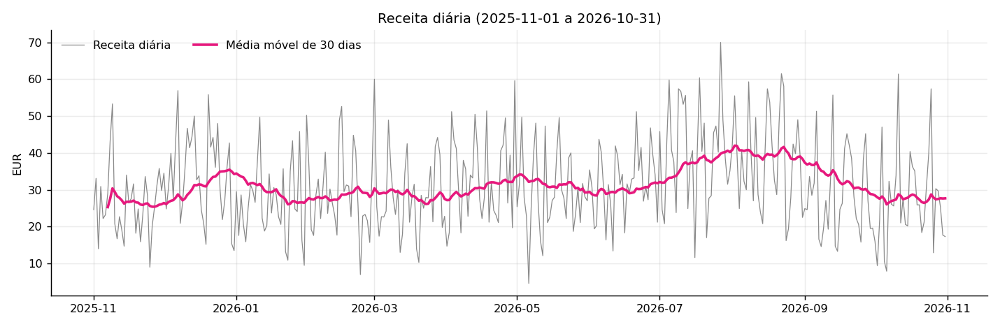
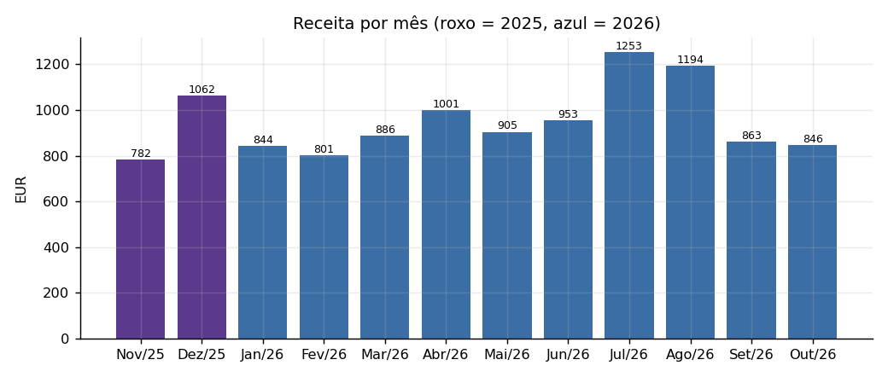
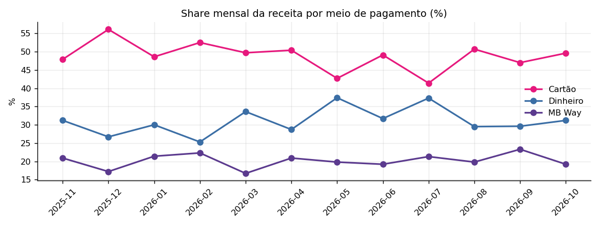
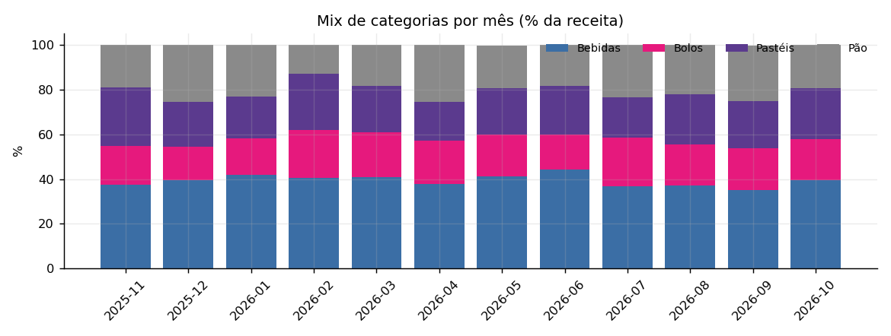
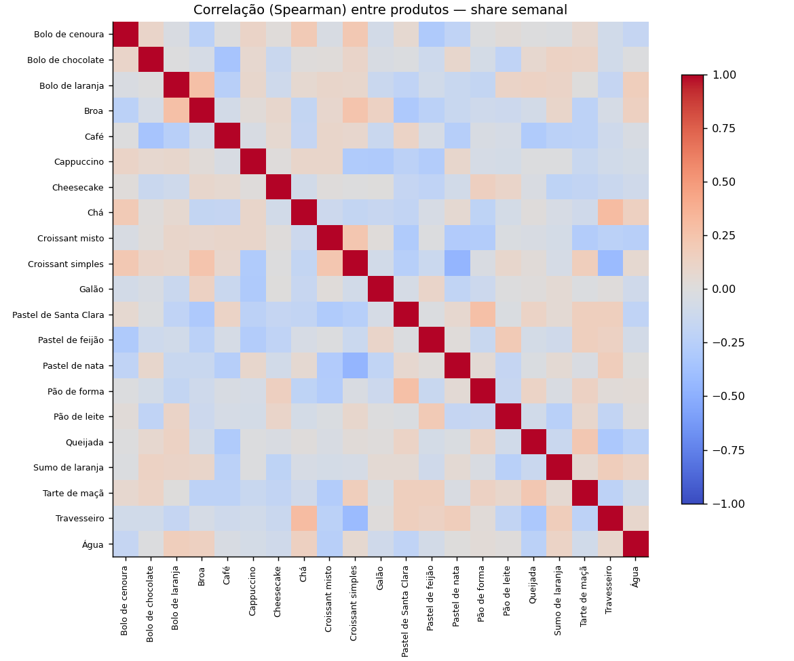

# Análise dos dados da pastelaria

Relatório de análise exploratória do ficheiro `pastelaria.xlsx`
(3 folhas: `produtos`, `ingredientes`, `vendas`).

- **Fonte:** `C:\Users\USER\Desktop\pastelaria.xlsx`
- **Período:** 2025-11-01 a 2026-10-31 (365 dias, sem falhas)
- **Volume:** 4 583 linhas de venda · 21 produtos · 16 ingredientes
- **Receita total:** 11 389,70 € · **lucro bruto:** 8 319,78 € · **margem:** 73,0 %
- **Análise gerada por:** [`analise.py`](./analise.py) · dados em [`dados/`](./dados) · gráficos em [`graficos/`](./graficos)

---

## 1. Resumo executivo

1. **O negócio é sustentado por bebidas.** Café, Galão e Cappuccino são 15,5 % da receita mas **29,3 % do lucro bruto**. As Bebidas, no seu conjunto, dão 39,3 % da receita e 42,6 % do lucro com a margem mais alta do catálogo (79,2 %).
2. **Poucos produtos fazem quase todo o lucro.** Os 5 melhores produtos geram **46,6 %** do lucro; **13 dos 21** chegam para ~80 % (Pareto).
3. **O fim de semana vale quase o dobro.** Sábado e domingo fazem **40,51 €/dia** contra 27,45 €/dia de segunda a sexta (+47,6 %, p < 0,001), e concentram 37,3 % da receita em apenas 28,8 % dos dias.
4. **O pico diário é o pequeno-almoço.** As horas 7–9 fazem **32,6 % da receita** em 3 das 13 horas de funcionamento; há um segundo pico às 13h e às 16h.
5. **A pergunta "produtos × ingredientes" não tem resposta nos dados atuais.** Não existe nenhuma tabela de receitas/fichas técnicas que ligue produtos a ingredientes. Uma correlação só será calculável depois de acrescentar essa folha (secção 5).
6. **Os meios de pagamento não mudaram ao longo do ano.** Cartão ~49 %, Dinheiro ~31 %, MB Way ~20 %, composição estável (χ², p = 0,50) e sem tendência significativa (todos os p ≥ 0,25).
7. **Não há crescimento demonstrável em 2026.** A receita/dia subiu 3,8 % face a novembro–dezembro de 2025, mas a tendência interna de 2026 não é significativa (p = 0,057) e **os dois anos não partilham um único mês**, pelo que uma comparação homóloga é impossível só com estes dados.

---

## 2. Modelo de dados

| Folha | Linhas | Colunas | Papel |
|---|---:|---|---|
| `produtos` | 21 | `id, name, category, unit_price, cost_price, stock, min_stock` | catálogo + preço de venda e custo de produção por unidade |
| `ingredientes` | 16 | `id, name, category, unit, unit_cost, stock, min_stock, supplier` | matérias-primas e embalagens (foto pontual do stock) |
| `vendas` | 4 583 | `id, date, hour, product_id, quantity, unit_price, payment_method` | linha de venda |

**Ligação existente:** `vendas.product_id` → `produtos.id`.
Verificado: nenhum `product_id` órfão, nenhum produto sem vendas, e `vendas.unit_price` coincide com `produtos.unit_price` nas 21 combinações produto/preço (0 divergências).

**O que falta no modelo:**

- Não existe **`receita` / ficha técnica** (`product_id`, `ingredient_id`, `quantity`, `unit`). É esta a peça que impede a análise produtos ↔ ingredientes.
- `vendas.id` identifica a **linha**, não o **recibo**. Não é possível reconstruir o cabaz de um cliente.
- Não há campo de **desconto/promoção**; como o preço de venda é sempre igual ao de tabela, a receita registada é sempre a nominal.
- O `stock` de produtos e ingredientes é um **snapshot**, não um histórico de movimentos — não reconcilia com 365 dias de vendas (20 dos 21 produtos venderam mais unidades do que o stock atual).

### Armadilha a evitar

As duas folhas partilham nomes de colunas (`id`, `name`, `category`, `stock`, `min_stock`), mas os `id` são **sequências independentes** (produtos 1–21, ingredientes 1–16). Um `JOIN ... ON id` produz pares sem qualquer significado:

| produto | categoria | "ingrediente" (join por id) |
|:--|:--|:--|
| Bolo de chocolate | Bolos | Farinha T55 |
| Cheesecake | Bolos | Manteiga |
| Bolo de laranja | Bolos | Chocolate negro |

**Não usar.** Esta é a razão pela qual não se apresenta nenhuma correlação produto↔ingrediente na secção 5.

---

## 3. Qualidade dos dados

Relatório automático da skill (`validate_dataset.py`, folha `vendas`): **97,5/100 (A — Excelente)**.

| Verificação | Resultado |
|:--|:--|
| Linhas / colunas em `vendas` | 4 583 / 7 |
| Valores nulos | 0 |
| `id` de venda duplicado | 0 |
| `product_id` sem correspondência | 0 |
| Produtos sem vendas | 0 |
| Preços divergentes de `produtos` | 0 |
| Cobertura temporal | 365 de 365 dias (0 falhas) |
| Horas | 7h–19h |
| Quantidade por linha | 1–4 |
| Meios de pagamento | Cartão, Dinheiro, MB Way |

**Observações do validador que não são erros:**

- 225 linhas (4,9 %) marcadas como *outliers* em `quantity` — é apenas o valor 4, que fica fora do intervalo interquartil por a escala ser discreta (1–4). Não há quantidades absurdas.
- `id` de venda é sequencial e uniforme (1…4583): serve só como identificador, não tem valor analítico.
- **43 pares de linhas exatamente iguais** (mesma data, hora, produto, quantidade e pagamento). Se se mantiver só uma cópia de cada par, a receita desce 59,10 € (0,52 %), as unidades 50 e o lucro 45,58 € — dentro do ruído, mas convém confirmar se são compras repetidas legítimas ou erros de registo.
- **A ordem das linhas não é cronológica dentro do dia**: só 1 dos 365 dias tem as horas por ordem. Agregar por dia/hora não é afetado, mas ler a série pela ordem do ficheiro é enganador.

**Anomalias que vale a pena confirmar:**

1. **2026-05-06 (quarta-feira): 4,60 € e 3 unidades** — o dia mais fraco de 365, com ~1/7 da mediana. Provável encerramento, feriado ou falha de registo.
2. **Chocolate negro com stock 0** enquanto os produtos de chocolate continuam a vender (Bolo de chocolate: 200 unidades). Ou a receita não usa este ingrediente, ou o stock não é atualizado — impossível decidir sem a ficha técnica.
3. **5 ingredientes abaixo do stock mínimo**: Farinha T55 (60 % do mínimo), Chocolate negro (0 %), Amêndoa (80 %), Caixas de bolo (45 %), Copos take-away (75 %). Todos os 21 produtos estão acima do mínimo.

---

## 4. Rentabilidade: que produtos dão mais lucro

Lucro = (preço de venda − custo de produção) × quantidade.

**Totais:** receita 11 389,70 € · custo de produção 3 069,92 € · **lucro bruto 8 319,78 €** · margem global 73,0 %.

### Ranking por lucro total

| id | produto | categoria | unidades | preço médio | custo unit. | receita | lucro | lucro/unid | margem % | % lucro |
|---:|:--|:--|---:|---:|---:|---:|---:|---:|---:|---:|
| 16 | Café | Bebidas | 1 716 | 0,80 | 0,12 | 1 372,80 | **1 166,88** | 0,68 | 85,0 | 14,0 |
| 17 | Galão | Bebidas | 804 | 1,30 | 0,25 | 1 045,20 | **844,20** | 1,05 | 80,8 | 10,1 |
| 18 | Cappuccino | Bebidas | 451 | 1,80 | 0,40 | 811,80 | **631,40** | 1,40 | 77,8 | 7,6 |
| 6 | Pastel de nata | Pastéis | 597 | 1,40 | 0,35 | 835,80 | **626,85** | 1,05 | 75,0 | 7,5 |
| 14 | Croissant misto | Pão | 358 | 2,60 | 0,90 | 930,80 | **608,60** | 1,70 | 65,4 | 7,3 |
| 19 | Sumo de laranja | Bebidas | 328 | 2,50 | 0,80 | 820,00 | 557,60 | 1,70 | 68,0 | 6,7 |
| 13 | Croissant simples | Pão | 416 | 1,20 | 0,30 | 499,20 | 374,40 | 0,90 | 75,0 | 4,5 |
| 1 | Bolo de chocolate | Bolos | 200 | 2,80 | 1,00 | 560,00 | 360,00 | 1,80 | 64,3 | 4,3 |
| 8 | Queijada | Pastéis | 322 | 1,50 | 0,40 | 483,00 | 354,20 | 1,10 | 73,3 | 4,3 |
| 10 | Travesseiro | Pastéis | 230 | 1,90 | 0,55 | 437,00 | 310,50 | 1,35 | 71,1 | 3,7 |
| 12 | Broa | Pão | 167 | 2,50 | 0,80 | 417,50 | 283,90 | 1,70 | 68,0 | 3,4 |
| 3 | Cheesecake | Bolos | 141 | 3,20 | 1,20 | 451,20 | 282,00 | 2,00 | 62,5 | 3,4 |
| 2 | Bolo de cenoura | Bolos | 156 | 2,60 | 0,90 | 405,60 | 265,20 | 1,70 | 65,4 | 3,2 |
| 11 | Pão de forma | Pão | 171 | 2,20 | 0,70 | 376,20 | 256,50 | 1,50 | 68,2 | 3,1 |
| 5 | Bolo de laranja | Bolos | 156 | 2,40 | 0,80 | 374,40 | 249,60 | 1,60 | 66,7 | 3,0 |
| 7 | Pastel de feijão | Pastéis | 205 | 1,60 | 0,45 | 328,00 | 235,75 | 1,15 | 71,9 | 2,8 |
| 9 | Pastel de Santa Clara | Pastéis | 183 | 1,70 | 0,50 | 311,10 | 219,60 | 1,20 | 70,6 | 2,6 |
| 20 | Chá | Bebidas | 208 | 1,20 | 0,15 | 249,60 | 218,40 | 1,05 | 87,5 | 2,6 |
| 4 | Tarte de maçã | Bolos | 109 | 2,90 | 1,00 | 316,10 | 207,10 | 1,90 | 65,5 | 2,5 |
| 15 | Pão de leite | Pão | 477 | 0,40 | 0,10 | 190,80 | 143,10 | 0,30 | 75,0 | 1,7 |
| 21 | Água | Bebidas | 248 | 0,70 | 0,20 | 173,60 | 124,00 | 0,50 | 71,4 | 1,5 |



### Por categoria

| categoria | unidades | receita | lucro | margem % | % receita | % lucro |
|:--|---:|---:|---:|---:|---:|---:|
| Bebidas | 3 755 | 4 473,00 | 3 542,48 | 79,2 | 39,3 | 42,6 |
| Pastéis | 1 537 | 2 394,90 | 1 746,90 | 72,9 | 21,0 | 21,0 |
| Pão | 1 589 | 2 414,50 | 1 666,50 | 69,0 | 21,2 | 20,0 |
| Bolos | 762 | 2 107,30 | 1 363,90 | 64,7 | 18,5 | 16,4 |

### Leitura

- **Margem percentual e lucro absoluto apontam para o mesmo lado:** Café tem 85 % de margem e é o maior lucro; Chá tem 87,5 % mas vende pouco. Margem alta sem volume não paga a renda.
- **A margem mais alta está no produto mais barato.** Bebidas dominam: custo de 0,12–0,40 € para um preço de 0,80–1,80 €.
- **Margem mais baixa:** Cheesecake (62,5 %), Bolo de chocolate (64,3 %) e Croissant misto (65,4 %) — mas o Croissant misto é o 5.º em lucro, porque o preço absoluto compensa.
- **Maior lucro por unidade:** Cheesecake 2,00 €, Tarte de maçã 1,90 €, Bolo de chocolate 1,80 €. **Menor:** Pão de leite 0,30 €, Água 0,50 €, Café 0,68 €.
- **Concentração:** top 5 = 46,6 % do lucro; 13 produtos = ~80 %.



---

## 5. Produtos × ingredientes: o que os dados permitem (e o que não permitem)

**Resposta direta: não é possível calcular esta correlação com o ficheiro atual.**

Motivo: não existe chave que ligue um produto aos seus ingredientes. As duas folhas só têm em comum nomes de colunas genéricos, e os `id` são independentes. Não há quantidades de receita, nem rendimentos, nem perdas.

### O que falta, concretamente

Uma folha `receita` (ou `ficha_tecnica`), por exemplo:

| product_id | ingredient_id | quantidade | unidade |
|---:|---:|---:|:--|
| 1 | 1 | 0,250 | kg |
| 1 | 2 | 0,150 | kg |
| 1 | 5 | 0,100 | kg |

Com essa folha passaria a ser possível, sem mais nada:

- custo teórico por produto (a partir dos `unit_cost`), para **validar ou substituir o `cost_price`** atual;
- consumo teórico de cada ingrediente e comparação com as vendas — deteta ruturas e desperdício;
- **correlação real** produto ↔ ingrediente, e sensibilidade do lucro a cada matéria-prima;
- identificação dos produtos expostos a cada fornecedor (risco de rutura).

### O que já se pode dizer sobre os ingredientes

- Valor do stock de ingredientes: **540,70 €**.
- Concentração por fornecedor: **Lacticínios Serra 228,80 € (42,3 %)**; Especiarias do Sul 78,00 €; Embalagens Costa 73,30 €; Fruta da Beira 62,50 €; Avícola Central 46,80 €; Doce Norte 28,50 €; Moagem do Vale 22,80 €.
- **5 de 16 ingredientes abaixo do mínimo**, incluindo Chocolate negro a zero. Embalagens Costa é o único fornecedor com dois artigos em alerta.

| ingrediente | unidade | stock | mínimo | cobertura | valor | fornecedor |
|:--|:--|---:|---:|---:|---:|:--|
| Farinha T55 | kg | 12 | 20 | 60 % | 10,20 | Moagem do Vale |
| Chocolate negro | kg | 0 | 5 | 0 % | 0,00 | Doce Norte |
| Amêndoa | kg | 4 | 5 | 80 % | 50,00 | Especiarias do Sul |
| Caixas de bolo | un | 18 | 40 | 45 % | 6,30 | Embalagens Costa |
| Copos take-away | un | 150 | 200 | 75 % | 12,00 | Embalagens Costa |

### Substituto disponível: co-movimento entre produtos

Sem a receita, a correlação que **é** calculável é entre produtos — que produtos sobem e descem juntos. Feito sobre a **share semanal** (53 semanas, para retirar o efeito de "semana movimentada"), com Spearman:

| par | ρ | significativo a 5 % |
|:--|---:|:--|
| Chá + Travesseiro | 0,298 | sim |
| Bolo de laranja + Broa | 0,278 | sim |
| Pastel de Santa Clara + Pão de forma | 0,275 | não |
| Broa + Croissant simples | 0,244 | não |
| Croissant misto + Croissant simples | 0,234 | não |

| par | ρ | significativo a 5 % |
|:--|---:|:--|
| Croissant simples + Pastel de nata | −0,455 | sim |
| Croissant simples + Travesseiro | −0,422 | sim |
| Bolo de chocolate + Café | −0,347 | sim |
| Queijada + Travesseiro | −0,317 | sim |
| Cappuccino + Galão | −0,304 | sim |

**Como ler isto com rigor:** só os pares *positivos* são interpretáveis como "vendem-se nas mesmas semanas". As correlações **negativas estão inflacionadas pela construção da medida** — como as shares somam 100 %, quando uma sobe as outras têm de descer. Não significam que os produtos se "anulem". O valor crítico de |ρ| a 5 % com 53 semanas é 0,277.

Conclusão honesta: **o sinal é fraco.** Mesmo o par mais forte (0,298) explica menos de 9 % da variação. Não há, nestes dados, combinações de produtos com força suficiente para justificar decisões por si só.

---

## 6. Produtos mais vendidos — valor e quantidade

### Por receita

| produto | categoria | unidades | receita | lucro | margem % |
|:--|:--|---:|---:|---:|---:|
| Café | Bebidas | 1 716 | 1 372,80 | 1 166,88 | 85,0 |
| Galão | Bebidas | 804 | 1 045,20 | 844,20 | 80,8 |
| Croissant misto | Pão | 358 | 930,80 | 608,60 | 65,4 |
| Pastel de nata | Pastéis | 597 | 835,80 | 626,85 | 75,0 |
| Sumo de laranja | Bebidas | 328 | 820,00 | 557,60 | 68,0 |
| Cappuccino | Bebidas | 451 | 811,80 | 631,40 | 77,8 |
| Bolo de chocolate | Bolos | 200 | 560,00 | 360,00 | 64,3 |
| Croissant simples | Pão | 416 | 499,20 | 374,40 | 75,0 |
| Queijada | Pastéis | 322 | 483,00 | 354,20 | 73,3 |
| Cheesecake | Bolos | 141 | 451,20 | 282,00 | 62,5 |

### Por quantidade

| produto | categoria | unidades | receita | lucro | margem % |
|:--|:--|---:|---:|---:|---:|
| Café | Bebidas | 1 716 | 1 372,80 | 1 166,88 | 85,0 |
| Galão | Bebidas | 804 | 1 045,20 | 844,20 | 80,8 |
| Pastel de nata | Pastéis | 597 | 835,80 | 626,85 | 75,0 |
| Pão de leite | Pão | 477 | 190,80 | 143,10 | 75,0 |
| Cappuccino | Bebidas | 451 | 811,80 | 631,40 | 77,8 |
| Croissant simples | Pão | 416 | 499,20 | 374,40 | 75,0 |
| Croissant misto | Pão | 358 | 930,80 | 608,60 | 65,4 |
| Sumo de laranja | Bebidas | 328 | 820,00 | 557,60 | 68,0 |
| Queijada | Pastéis | 322 | 483,00 | 354,20 | 73,3 |
| Água | Bebidas | 248 | 173,60 | 124,00 | 71,4 |

### O ranking muda com a métrica

- **Pão de leite** é o 4.º em quantidade (477 un) e apenas o **20.º** em receita (190,80 €): é um produto de tráfego, não de margem (0,30 €/un).
- **Croissant misto** é o 3.º em receita (930,80 €) mas o 7.º em quantidade — vende menos e mais caro.
- **Água** entra no top 10 por quantidade mas é o último em lucro total.
- Em 365 dias: **7 643 unidades**, 1,67 unidades por linha, ticket médio por linha **2,49 €**.

---

## 7. Quando se vende: dias e horas

### Dia da semana

| dia | nº dias | receita | unidades | receita/dia | unid/dia | % receita |
|:--|---:|---:|---:|---:|---:|---:|
| Segunda | 52 | 1 460,60 | 996 | 28,09 | 19,15 | 12,8 |
| Terça | 52 | 1 377,90 | 951 | 26,50 | 18,29 | 12,1 |
| Quarta | 52 | 1 455,70 | 951 | 27,99 | 18,29 | 12,8 |
| Quinta | 52 | 1 367,10 | 950 | 26,29 | 18,27 | 12,0 |
| Sexta | 52 | 1 475,10 | 951 | 28,37 | 18,29 | 13,0 |
| Sábado | 53 | 2 082,80 | 1 395 | 39,30 | 26,32 | 18,3 |
| Domingo | 52 | 2 170,50 | 1 449 | **41,74** | 27,87 | 19,1 |



| segmento | receita | unidades | receita/dia | unid/dia | % receita |
|:--|---:|---:|---:|---:|---:|
| Dia de semana (seg–sex) | 7 136,40 | 4 799 | 27,45 | 18,46 | 62,7 |
| Fim de semana (sáb–dom) | 4 253,30 | 2 844 | **40,51** | 27,09 | 37,3 |

Teste de Mann-Whitney sobre a receita diária: **p < 0,001** — a diferença não é ruído. O fim de semana fatura **+47,6 % por dia** com +46,8 % de unidades; o ticket por linha é praticamente igual (2,51 € vs 2,47 €), ou seja **o fim de semana traz mais gente, não gente que gasta mais por linha**.

### Dias com mais receita

| data | dia | receita | unidades | linhas | ticket médio |
|:--|:--|---:|---:|---:|---:|
| 2026-07-27 | Segunda | **70,00** | 38 | 18 | 3,89 |
| 2026-08-22 | Sábado | 61,50 | 42 | 19 | 3,24 |
| 2026-10-11 | Domingo | 61,40 | 36 | 17 | 3,61 |
| 2026-07-18 | Sábado | 60,40 | 38 | 22 | 2,75 |
| 2026-03-01 | Domingo | 60,00 | 39 | 20 | 3,00 |
| 2026-07-05 | Domingo | 59,80 | 41 | 23 | 2,60 |
| 2026-04-30 | Quinta | 59,60 | 31 | 17 | 3,51 |
| 2026-08-08 | Sábado | 59,30 | 38 | 24 | 2,47 |
| 2026-08-23 | Domingo | 58,10 | 38 | 22 | 2,64 |
| 2026-10-25 | Domingo | 57,40 | 40 | 20 | 2,87 |

- **8 dos 10 melhores dias são de fim de semana**; as exceções são 2026-07-27 (segunda, o máximo absoluto) e 2026-04-30 (quinta).
- **Por quantidade** o topo é outro: 2026-09-06 (domingo, 42 un, 51,30 €) e 2026-08-22 (sábado, 42 un, 61,50 €). O dia de maior receita não é o de maior volume — 27/07 vendeu só 38 unidades mas com ticket médio de 3,89 €.
- Distribuição dos 365 dias: < 10 € → 6 dias · 10–20 € → 55 · 20–40 € → 211 · 40–60 € → 88 · ≥ 60 € → 5.
- Os 10 melhores dias fazem 5,3 % da receita anual; o dia mais fraco (2026-05-06, 4,60 €) vale 0,04 %.

### Horas

| hora | receita | unidades | % receita |
|---:|---:|---:|---:|
| 7h | 1 131,70 | 738 | 9,9 |
| **8h** | **1 361,00** | **918** | **11,9** |
| 9h | 1 215,00 | 822 | 10,7 |
| 10h | 944,40 | 614 | 8,3 |
| 11h | 735,00 | 483 | 6,5 |
| 12h | 840,40 | 555 | 7,4 |
| 13h | 1 005,70 | 689 | 8,8 |
| 14h | 830,50 | 582 | 7,3 |
| 15h | 681,70 | 456 | 6,0 |
| 16h | 976,10 | 643 | 8,6 |
| 17h | 781,60 | 544 | 6,9 |
| 18h | 547,70 | 392 | 4,8 |
| 19h | 338,90 | 207 | 3,0 |



- **Pico: 8h**, seguido de 9h e 7h. As 7–9h somam **3 707,70 € (32,6 %)** em 3 horas.
- **Segundo pico às 13h** (1 005,70 €) e um terceiro às 16h (976,10 €) — provavelmente almoço e lanche.
- **Vales:** 11h (6,5 %), 15h (6,0 %) e o fecho, 18–19h (7,8 % no conjunto).
- O perfil horário é **igual em todos os dias da semana** (χ² dia×hora: p = 0,77). O fim de semana não muda a forma da curva, só a amplifica — visível no heatmap.



---

## 8. Totais por ano, mês e dia



### Série diária (365 dias)

| estatística | valor |
|:--|:--|
| receita total | 11 389,70 € |
| média por dia | 31,20 € |
| mediana | 29,20 € |
| desvio padrão | 12,08 € |
| mínimo | 4,60 € (2026-05-06) |
| máximo | 70,00 € (2026-07-27) |
| percentil 25 / 75 | 22,30 € / 40,00 € |
| dias sem vendas | 0 |
| linhas por dia | 12,56 |
| unidades por dia | 20,94 |

A série completa, dia a dia, está em [`dados/04_serie_diaria.csv`](./dados/04_serie_diaria.csv).

### Por mês

| mês | dias | linhas | unidades | receita | receita/dia | unid/dia | ticket médio |
|:--|---:|---:|---:|---:|---:|---:|---:|
| 2025-11 (Nov) | 30 | 311 | 515 | 782,40 | 26,08 | 17,17 | 2,52 |
| 2025-12 (Dez) | 31 | 417 | 701 | 1 062,40 | 34,27 | 22,61 | 2,55 |
| 2026-01 (Jan) | 31 | 330 | 565 | 843,70 | 27,22 | 18,23 | 2,56 |
| 2026-02 (Fev) | 28 | 314 | 543 | 801,30 | 28,62 | 19,39 | 2,55 |
| 2026-03 (Mar) | 31 | 358 | 595 | 886,10 | 28,58 | 19,19 | 2,48 |
| 2026-04 (Abr) | 30 | 369 | 646 | 1 000,60 | 33,35 | 21,53 | 2,71 |
| 2026-05 (Mai) | 31 | 370 | 600 | 904,60 | 29,18 | 19,35 | 2,44 |
| 2026-06 (Jun) | 30 | 407 | 678 | 953,20 | 31,77 | 22,60 | 2,34 |
| **2026-07 (Jul)** | 31 | 474 | 806 | **1 253,10** | **40,42** | 26,00 | 2,64 |
| **2026-08 (Ago)** | 31 | 489 | 809 | **1 193,50** | **38,50** | 26,10 | 2,44 |
| 2026-09 (Set) | 30 | 384 | 594 | 862,60 | 28,75 | 19,80 | 2,25 |
| 2026-10 (Out) | 31 | 360 | 591 | 846,20 | 27,30 | 19,06 | 2,35 |



**Julho e agosto são o pico** (40,42 e 38,50 €/dia, ou seja +29,6 % e +23,4 % sobre a média dos 365 dias, 31,20 €/dia). Os meses mais fracos são janeiro, outubro e novembro (~26–28 €/dia). O padrão é compatível com sazonalidade de verão, não com crescimento. (A média de 2026 é 31,40 €/dia, mas esse ano só tem 304 dias; usá-la como média anual inflacionava os picos.)

### Por ano

| ano | dias | linhas | unidades | receita | receita/dia | unid/dia | ticket médio | preço médio/unid |
|:--|---:|---:|---:|---:|---:|---:|---:|---:|
| 2025 | 61 | 728 | 1 216 | 1 844,80 | 30,24 | 19,93 | 2,53 | 1,52 |
| 2026 | 304 | 3 855 | 6 427 | 9 544,90 | 31,40 | 21,14 | 2,48 | 1,48 |

### 2026 vs 2025 — a comparação que os dados não permitem

**Os dois anos não partilham um único mês.** O período começa em 2025-11-01, portanto 2025 tem apenas **novembro e dezembro** (61 dias); 2026 tem **janeiro a outubro** (304 dias). Somar "2026 contra 2025" dá +417,4 % de receita — mas isso é só a diferença entre 10 meses e 2 meses, **não é crescimento**.

| leitura | 2025 | 2026 | variação |
|:--|---:|---:|---:|
| receita total | 1 844,80 € | 9 544,90 € | +417,4 % (não comparável) |
| unidades | 1 216 | 6 427 | +428,5 % (não comparável) |
| **receita/dia** | **30,24 €** | **31,40 €** | **+3,8 %** |
| unidades/dia | 19,93 | 21,14 | +6,1 % |
| ticket médio/linha | 2,53 € | 2,48 € | −1,9 % |
| preço médio/unidade | 1,52 € | 1,48 € | −2,6 % |

A comparação normalizada por dia (+3,8 %) é a única defensável, e mesmo assim **é entre estações diferentes** (nov–dez vs jan–out), pelo que mistura crescimento com sazonalidade.

**Meses homólogos:** inexistentes. Nenhum mês de 2025 se repete em 2026.

**Comparação por dia da semana** (esta sim, normalizada e com a mesma composição semanal, porque 365 dias = 52 semanas + 1 dia, de sábado a sábado):

| dia | 2025 (€/dia) | 2026 (€/dia) | variação |
|:--|---:|---:|---:|
| Segunda | 29,52 | 27,79 | −5,9 % |
| Terça | 24,98 | 26,82 | +7,4 % |
| Quarta | 26,19 | 28,37 | +8,3 % |
| Quinta | 28,75 | 25,84 | −10,1 % |
| Sexta | 24,60 | 29,05 | +18,1 % |
| Sábado | 36,77 | 39,82 | +8,3 % |
| Domingo | 40,10 | 42,08 | +4,9 % |

**Tendência dentro de 2026:** +0,0153 €/dia (≈ +0,46 €/mês), R² = 0,012, **p = 0,057** → não significativa. Com estes dados não se pode afirmar que 2026 esteja a crescer; o que existe é sazonalidade (pico jul–ago) e um patamar estável.

> Para uma comparação homóloga real é necessário acrescentar novembro e dezembro de 2026 (ou, em alternativa, 12 meses completos de 2025).

---

## 9. Meios de pagamento

### Global

| meio | linhas | unidades | receita | % receita | % linhas | ticket médio/linha |
|:--|---:|---:|---:|---:|---:|---:|
| **Cartão** | 2 218 | 3 702 | 5 550,00 | **48,7** | 48,4 | 2,50 |
| Dinheiro | 1 425 | 2 384 | 3 548,60 | 31,2 | 31,1 | 2,49 |
| MB Way | 940 | 1 557 | 2 291,10 | 20,1 | 20,5 | 2,44 |



### Evolução mensal (% da receita)

| mês | Cartão | Dinheiro | MB Way |
|:--|---:|---:|---:|
| 2025-11 | 47,9 | 31,2 | 20,9 |
| 2025-12 | **56,1** | 26,7 | 17,2 |
| 2026-01 | 48,6 | 30,0 | 21,4 |
| 2026-02 | 52,5 | 25,3 | 22,3 |
| 2026-03 | 49,7 | 33,6 | 16,7 |
| 2026-04 | 50,4 | 28,7 | 20,9 |
| 2026-05 | 42,7 | 37,4 | 19,8 |
| 2026-06 | 49,1 | 31,7 | 19,2 |
| 2026-07 | **41,4** | **37,3** | 21,3 |
| 2026-08 | 50,7 | 29,5 | 19,8 |
| 2026-09 | 47,0 | 29,6 | 23,3 |
| 2026-10 | 49,6 | 31,2 | 19,2 |

### Houve alteração ao longo do tempo?

**Não.** Três verificações independentes concordam:

| teste | resultado | leitura |
|:--|:--|:--|
| χ² meio × mês | χ² = 21,3 · gl = 22 · **p = 0,50** | composição estável mês a mês |
| Regressão da share: Cartão | −0,40 pp/mês · **p = 0,25** | sem tendência |
| Regressão da share: Dinheiro | +0,30 pp/mês · **p = 0,36** | sem tendência |
| Regressão da share: MB Way | +0,09 pp/mês · **p = 0,59** | sem tendência |
| Kruskal-Wallis no valor por linha | H = 0,8 · **p = 0,67** | o valor da compra não depende do meio |

A ordem **Cartão > Dinheiro > MB Way** nunca se altera em nenhum dos 12 meses. As oscilações que se veem (Cartão a 56,1 % em dezembro, a 41,4 % em julho) são variação sazonal dentro do ruído, não uma mudança de hábito.

**Dois pormenores com valor operacional:**

- Em dezembro o Cartão sobe a 56,1 % — compras maiores de época.
- Em maio e julho o Dinheiro sobe a ~37 % e o Cartão desce a ~42 % — coincide com os meses de maior tráfego (turismo de verão paga mais em numerário).
- Por dia da semana a composição também é estável (Cartão 45,8–55,6 %), com o máximo à terça-feira e o mínimo à segunda e sábado.

---

## 10. Outras correlações e padrões

| relação | ρ (Spearman) | p | leitura |
|:--|---:|---:|:--|
| Receita diária vs dia da semana | 0,396 | < 0,001 | **efeito fim de semana confirmado** |
| Preço médio do produto vs unidades vendidas | −0,693 | 0,0005 | produtos mais baratos vendem mais (entre produtos) |
| Margem % do produto vs unidades vendidas | +0,732 | 0,0002 | os produtos de margem alta são também os mais vendidos |
| Receita diária vs tempo (365 dias) | 0,087 | 0,097 | sem tendência de crescimento |
| Preço unitário vs quantidade por linha | 0,014 | 0,35 | **não há** efeito de preço na quantidade comprada |
| Hora vs quantidade por linha | 0,012 | 0,41 | **não há** relação entre hora e tamanho da compra |
| Linhas por dia vs ticket médio por linha | 0,092 | 0,079 | dias cheios não têm tickets menores |

**Outros padrões relevantes:**

- **Receita diária e unidades diárias andam juntas** (r = 0,912): a receita varia sobretudo com o número de unidades, não com o preço. O preço médio por unidade é praticamente constante (1,48–1,52 € entre anos).
- **Mix de categorias estável**: Bebidas 35–44 % da receita em todos os meses (χ² categoria × mês: p = 0,68). Não há mudança de preferência ao longo do ano.
- **Perfil horário idêntico em todos os dias** (χ² dia × hora: p = 0,77).
- **A "contradição" margem/volume resolve-se assim:** os produtos de margem alta são as bebidas, que também são os de maior rotação. Não há aqui o clássico trade-off margem vs volume — há um produto (Café) que ganha nas duas dimensões.
- **Produtos de tráfego:** Pão de leite (477 un, 0,30 €/un de lucro) e Água (248 un, 0,50 €) puxam clientes mas contribuem pouco. Servem para acompanhar, não para rentabilizar.





### Calendário e dias atípicos

Desvio de cada data face à receita média do seu dia da semana (365 dias):

| data | dia | receita | desvio |
|:--|:--|---:|---:|
| 24 dez 2025 | Qua | 48,00 € | +71 % |
| 25 dez 2025 | Qui | 30,10 € | +15 % |
| 31 dez 2025 | Qua | 13,50 € | −52 % |
| 1 jan 2026 | Qui | 29,50 € | +12 % |
| 3 abr 2026 | Sex | 51,20 € | +80 % |
| 30 abr 2026 | Qui | 59,60 € | +127 % |
| 2 out 2026 | Sex | 9,40 € | −67 % |
| 5 out 2026 | Seg | 10,60 € | −62 % |
| 6 out 2026 | Ter | 7,90 € | −70 % |
| 27 jul 2026 | Seg | 70,00 € | +149 % |

- A **véspera de Natal** é um dia de compras (+71 %), mas a **passagem de ano** cai para metade (−52 %). O dia de Natal (+15 %) e o 1 de janeiro (+12 %) ficam perto do normal.
- O **feriado de 5 de outubro** (10,60 €, −62 %) vem rodeado de dias muito fracos: 2 out (−67 %) e 6 out (−70 %). Em contrapartida, a **véspera de 1 de maio** é o 7.º melhor dia do ano (59,60 €, +127 %), embora o próprio feriado seja apenas 25,40 €.
- Os desvios diários têm **autocorrelação +0,22** (descontado o dia da semana): os bons e maus dias vêm em sequência, o que sugere fatores externos (meteorologia, obras, eventos) que os dados não registam.
- **Não há efeito de dia de pagamento**: a receita ajustada é 0,96 nos dias 1–5 do mês e 1,03 nos dias 16–20.
- Estas leituras são descritivas: com um ano de dados assinalam-se os dias fora do padrão, mas não se estima um efeito de calendário.

---

## 11. Limitações

1. **Sem ficha técnica** não há custo por ingrediente, nem consumo, nem correlação produto↔ingrediente. O `cost_price` é aceite como dado, sem verificação.
2. **Sem identificador de recibo** não se mede o cabaz por cliente — só por linha. "Ticket médio" aqui é sempre por linha (2,49 €), não por compra.
3. **Sem descontos**: `vendas.unit_price` é sempre igual ao preço de tabela, pelo que a receita real pode estar sobrestimada se houver promoções fora do sistema.
4. **Stock é um snapshot** e não reconcilia com as vendas; não serve para calcular consumo nem ruturas históricas.
5. **Dois anos sem sobreposição** — qualquer comparação 2025/2026 é entre estações diferentes.
6. **Ano incompleto**: 2026 termina em outubro, 2025 começa em novembro.
7. **IVA e custos fixos ausentes**: a margem de 73,0 % é margem bruta sobre custo de produção declarado; não inclui renda, pessoal, energia nem impostos.
8. **Amostra pequena para correlações de produto**: 53 semanas, com |ρ| crítico de 0,277; correlações de share têm viés negativo estrutural.
9. **Duplicados por confirmar**: os totais incluem 43 pares de linhas exatamente iguais; removê-los baixaria a receita em 59,10 € (0,52 %), pelo que os valores estão ligeiramente sobrestimados.

---

## 12. Recomendações

**Prioridade alta (desbloqueiam análises):**

1. **Criar a folha `receita`** (`product_id`, `ingredient_id`, `quantidade`, `unidade`). É a única forma de responder à pergunta 2 do pedido e de validar o `cost_price`. Sem isto, metade das decisões de custo fica em aberto.
2. **Acrescentar `id_venda` (recibo)** em `vendas`, para agrupar linhas do mesmo cliente. Permite ticket por compra, tamanho de cabaz e análise de combinações reais.
3. **Substituir o stock-snapshot por movimentos datados** (entradas/saídas), para calcular consumo, ruturas e rotação.

**Prioridade média (qualidade da análise):**

4. Registar **descontos** quando existirem, para que a receita seja a real.
5. Completar **novembro e dezembro de 2026** para permitir uma comparação homóloga com 2025.
6. Confirmar o dia **2026-05-06** (4,60 €, 3 unidades): encerramento, feriado ou falha de registo?

**Ações comerciais que os dados já suportam:**

7. **Reforçar stock e pessoal ao fim de semana** (40,51 €/dia vs 27,45 €/dia) e nas horas 7–9, 13 e 16.
8. **Proteger o Café** — 14 % do lucro num único produto com 85 % de margem e custo de 0,12 €. É o produto mais exposto a qualquer rutura de stock.
9. **Rever o preço dos Bolos com cuidado** (margem 64,7 %, a mais baixa): Cheesecake, Bolo de chocolate e Croissant misto concentram o custo. Um ajuste de 0,20 € em todos os bolos vale 152,40 €/ano; +0,10 € no Café vale 171,60 €/ano, mais em euros absolutos. Subir os bolos melhora a **margem percentual**; subir o Café rende mais **por unidade vendida**. Como os dados não têm variação de preço nem elasticidade, isto é uma comparação de cenários, não uma conclusão: a escolha exige um teste real de procura.
10. **Resolver os 5 alertas de stock de ingredientes**, com destaque para o Chocolate negro a zero e para as Embalagens Costa (2 artigos abaixo do mínimo, ambos necessários ao take-away).

---

## 13. Ficheiros e reprodução

```
docs/analise/
├── RELATORIO.md          este documento
├── analise.py            script completo (carrega, valida, analisa, grava)
├── requirements.txt      dependências
├── resumo.json           números-chave em formato máquina
├── dados/                27 tabelas CSV (UTF-8 com BOM, abrem no Excel)
└── graficos/             10 gráficos PNG
```

Tabelas principais:

| ficheiro | conteúdo |
|:--|:--|
| `01_integridade.csv` | verificações de qualidade e cobertura |
| `02_rentabilidade_produto.csv` | lucro, margem e peso de cada produto |
| `03_categorias.csv` | agregado por categoria |
| `04_serie_diaria.csv` | receita/unidades/linhas dos 365 dias |
| `05_dia_semana.csv` · `06_semana_vs_fim_semana.csv` | padrão semanal |
| `07_horas.csv` · `09_heatmap_dia_hora.csv` | padrão horário |
| `08_top_dias.csv` | melhores dias |
| `10_mensal.csv` · `11_anual.csv` · `12_comparacao_anos.csv` | agregados temporais |
| `13_dow_por_ano.csv` · `14_2026_vs_base_2025.csv` | comparações entre anos |
| `15_pagamentos.csv` · `16_pagamentos_mensal_share.csv` · `17_tendencia_pagamentos.csv` | meios de pagamento |
| `19_ingredientes_fornecedor.csv` · `20_ingredientes_stock.csv` | ingredientes e alertas |
| `22_correlacao_produtos.csv` · `23_pares_correlacao.csv` | co-movimento entre produtos |
| `24_correlacoes_gerais.csv` | testes estatísticos |

### Como voltar a correr

```bash
python -m venv .venv
.venv\Scripts\activate          # Windows
pip install -r requirements.txt

python analise.py "C:\caminho\pastelaria.xlsx" .
```

Requer Python 3.9+ com `pandas`, `numpy`, `scipy`, `openpyxl`, `matplotlib` e `tabulate`. Os resultados são determinísticos — não há amostragem nem aleatoriedade.

### Convenções

- Valores em EUR, arredondados a 2 casas na apresentação (os CSV têm mais precisão).
- "Lucro" = margem bruta sobre o custo de produção declarado; **não** é lucro líquido.
- "Ticket médio" = receita ÷ linhas de venda, **não** por recibo (não existe identificador de recibo).
- Dia da semana: segunda = 0 … domingo = 6. Fim de semana = sábado e domingo.
- Testes: Spearman para correlações não lineares/ordinais, Mann-Whitney e Kruskal-Wallis para diferenças entre grupos, χ² para independência em tabelas de contingência. Significância a 5 %.
